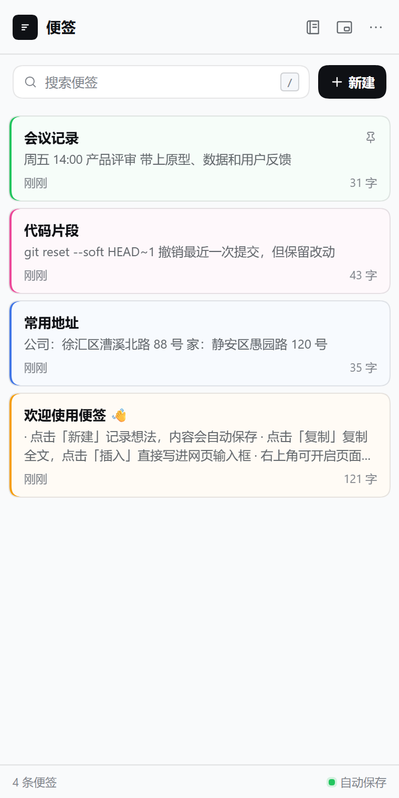
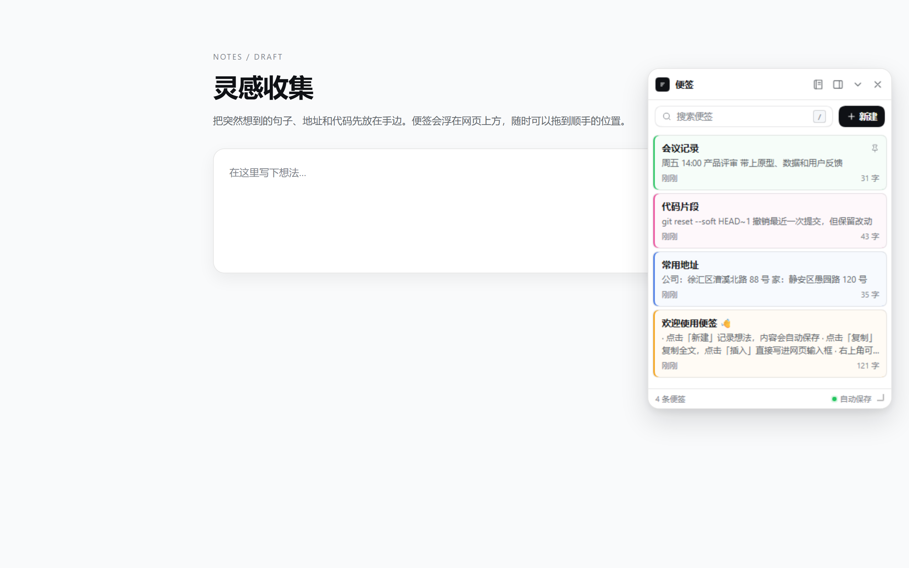
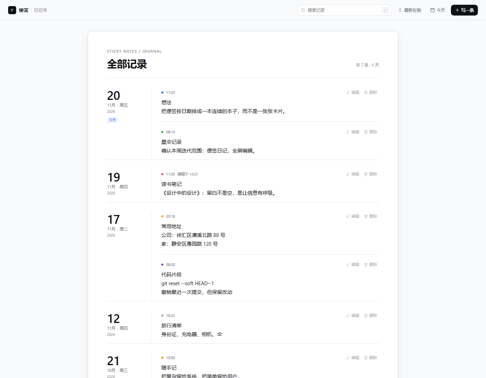

# 便签 · Sticky Notes

像 Windows 便签一样的 Chrome / Edge 扩展：在侧边栏、网页浮窗或全屏日记本里随手记，内容自动保存；随时查看、复制，或一键插入当前网页的输入框。界面沿用 DSH 的设计语言：中性色、细边框、系统字体与克制的蓝色强调。

**[下载最新版本](https://github.com/xm130812-byte/sticky-notes/releases/latest)** · Manifest V3 · 无需构建 · Chrome / Edge 116+

<p>
  
  
</p>

## 全屏日记本



在一个新标签页里把便签按创建日期排成一本连续的日记：左侧日期栏、右侧条目，不使用卡片列表。支持内联编辑、删除撤销、写一条、搜索，以及「最新在前 / 最早在前」排序。

- 从侧边栏或浮窗顶部的书本图标打开
- 也可以从侧边栏 `⋯` 菜单或右键扩展图标选择「打开全屏日记本」
- 编辑不会改变记录所属的日期；删除后 5 秒内可以撤销

## 设计

界面与 DSH 使用同一套视觉语言：

- 浅色 `#f9fafb / #ffffff`，深色 `#151517 / #1b1b1c / #232324` 的分层表面
- `0.5px` 细边框、`12–16px` 圆角、系统字体栈
- 主按钮浅色为黑色、深色为白色；蓝色仅用于链接、焦点和选中态
- 便签颜色用低饱和底色 + 左侧 2px 色条表达，亮 / 暗色自动跟随系统
- 全屏日记本沿用同一套颜色、圆角与排版规则，不引入新的卡片样式

## 功能

- **三种形态**：浏览器侧边栏、可拖动 / 缩放的页面浮窗，以及新标签页里的全屏日记本
- **自动保存**：输入即保存，关掉面板再打开内容还在
- **整理**：搜索、6 种颜色、置顶、删除后 5 秒内撤销
- **全屏日记本**：按创建日期连续排版；内联编辑、删除撤销、写一条、搜索、排序
- **复制 / 插入**：复制全文；或直接写进当前网页的 `textarea`、`input`、`contenteditable`
- **右键收集**：选中网页文字 → 右键 →「把所选文字存为便签」
- **导入 / 导出**：JSON 备份，换电脑或重装前先导出
- **亮 / 暗色**：跟随系统外观
- **纯本地**：数据只存在浏览器里，没有网络请求

## 安装

### 方式一：本机加载（需要开发者模式）

1. 下载并解压本目录（或直接使用 `sticky-notes` 文件夹）
2. Chrome 打开 `chrome://extensions`；Edge 打开 `edge://extensions`
3. 打开右上角的 **开发者模式**
4. 点击 **加载已解压的扩展程序**，选择包含 `manifest.json` 的这一层文件夹
5. 把「便签」固定到工具栏

无需 Node.js、Python 或任何构建步骤。要求 Chrome / Edge **116+**。

### 方式二：从商店安装（不需要开发者模式）

Chrome / Edge 只允许从官方商店安装扩展，手动拖入 `.crx` 会被浏览器拦截。想彻底摆脱开发者模式，只能发布到商店——成本是一次性 $5（Chrome）或免费（Edge），发布时可以选「不公开」，只给链接安装。

完整步骤、商品文案、权限理由和现成截图都在 [`store/`](store/)：

- [`store/发布指南.md`](store/发布指南.md) — 三条路线对比 + 逐步操作
- [`store/商店文案.md`](store/商店文案.md) — 名称、简述、详细说明（中英）
- [`store/权限说明.md`](store/权限说明.md) — 审核表单逐项可粘贴
- [`store/screenshots/`](store/screenshots/) — 5 张 1280×800 真实界面截图
- [`store/privacy-policy.html`](store/privacy-policy.html) — 可托管到 GitHub Pages 的隐私政策页

注意：商店版的扩展 ID 与本地加载版不同，`chrome.storage` 按 ID 隔离，迁移时用「导出全部便签」→「导入便签」。

## 使用

- 点击工具栏图标，或按 `Ctrl+Shift+Y` 打开侧边栏
- 侧边栏右上角的浮窗按钮可开启页面浮窗；也可以右键扩展图标选择「显示 / 隐藏便签浮窗」，或按 `Alt+Shift+S`
- 浮窗顶部按住可拖动，右下角可缩放，`⌄` 收起成一条标题栏，浮窗里的侧边栏按钮会切回侧边栏
- 点「新建」开始输入，内容会自动保存
- 编辑页底部：切换颜色、复制、插入；右上角：置顶、删除
- 侧边栏右上角 `⋯`：导出全部便签、导入便签、全屏日记本、查看快捷键
- 日记本里：悬停条目右侧可「编辑 / 删除」，触屏直接显示；编辑时 `Ctrl/⌘+Enter` 保存、`Esc` 取消；删除可撤销
- 日记本顶部可以搜索、切换排序、回到今天，或点「写一条」新增记录

### 快捷键

| 功能 | 快捷键 |
| --- | --- |
| 打开便签侧边栏 | `Ctrl+Shift+Y`（Mac：`⌘+Shift+Y`） |
| 显示 / 隐藏浮窗 | `Alt+Shift+S` |
| 新建便签 | `Alt+Shift+N` |
| 搜索便签 / 记录 | `/` |
| 插入到网页输入框 | `Ctrl/⌘+Enter`（侧边栏或浮窗编辑便签时） |
| 保存日记本编辑 | `Ctrl/⌘+Enter`（日记本编辑记录时） |

可在 `chrome://extensions/shortcuts` 中修改。

## 权限说明

| 权限 | 用途 |
| --- | --- |
| `storage` / `unlimitedStorage` | 在本地保存便签 |
| `sidePanel` | 打开浏览器侧边栏 |
| `contextMenus` | 右键菜单（打开便签、全屏日记本、收集选中文字） |
| `clipboardWrite` | 复制便签全文 |
| `<all_urls>` 内容脚本 | 在网页里显示浮窗；点击「插入」时把文本写入输入框 |

扩展不会上传数据，也不会在后台读取网页正文。只有你主动点击「插入」时，才会向当前页面的输入框写入便签文本。

## 数据与备份

- 便签保存在 `chrome.storage.local`，每条便签一个独立键，侧边栏、浮窗和日记本实时同步
- 日记本按 `createdAt`（创建日期）分组，编辑只更新内容与「编辑于」时间，不会移动所属日期
- 卸载扩展会**删除**本地便签，建议定期用「导出全部便签」备份
- 「导入便签」支持本扩展导出的 JSON；重复 ID 会自动分配新 ID，不会覆盖已有便签
- 数据只存在当前浏览器配置文件，不跨设备同步

## 已知限制

- `chrome://`、扩展商店、部分 PDF 查看器等受保护页面无法注入浮窗或插入文本
- 浮窗不能覆盖浏览器全屏内容（全屏元素位于浏览器 top layer）
- 插入支持普通 `input` / `textarea` / `contenteditable`；跨域 iframe 内的输入框、部分 Shadow DOM 输入框暂不支持，此时会退回到复制到剪贴板
- 浮窗在页面加载后出现；如果你在某个页面关闭了浮窗，所有页面会一起关闭（开关是全局的）

## 文件结构

```
sticky-notes/
├─ manifest.json        # MV3 清单
├─ background.js        # 右键菜单、快捷键、欢迎便签
├─ content.js           # 页面浮窗宿主 + 插入文本
├─ panel.html           # 侧边栏 / 浮窗共用界面
├─ panel.css
├─ panel.js
├─ journal.html         # 全屏日记本
├─ journal.css
├─ journal.js
├─ icons/               # 16 / 32 / 48 / 128 图标
├─ docs/                # README 预览图
└─ store/               # 商店上架材料（文案、权限理由、截图）
```

## 开发

纯原生 HTML / CSS / JavaScript，无构建步骤。修改后在 `chrome://extensions` 点击扩展卡片上的刷新按钮；改动 `content.js` 后还需要刷新已打开的网页，改动日记本页面后刷新对应标签页。

## License

MIT
